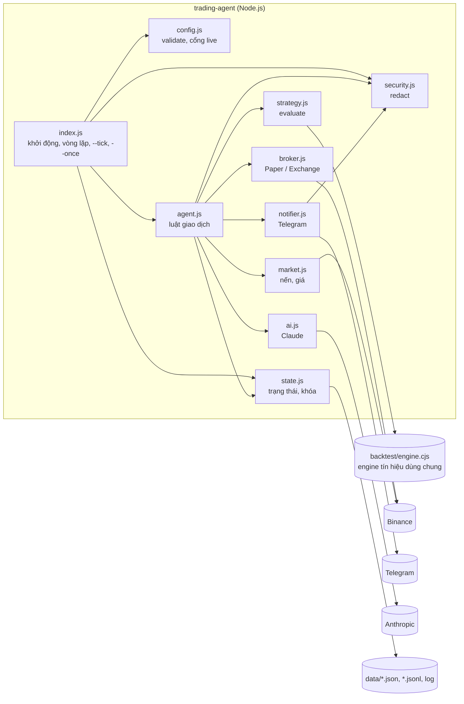
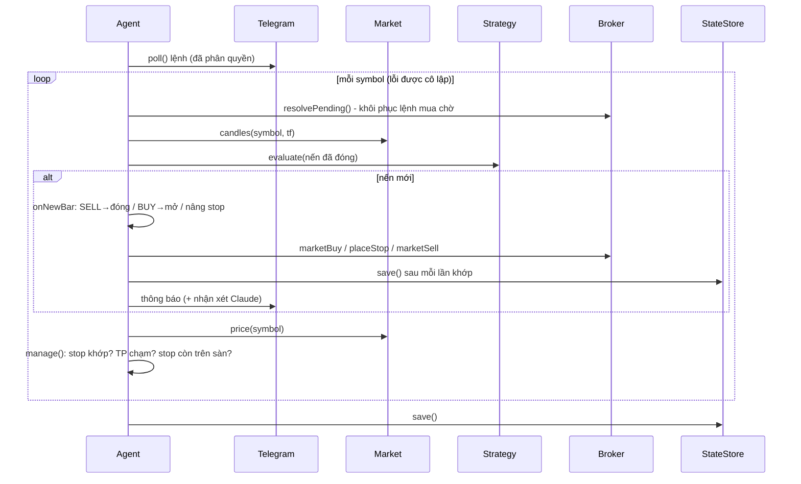
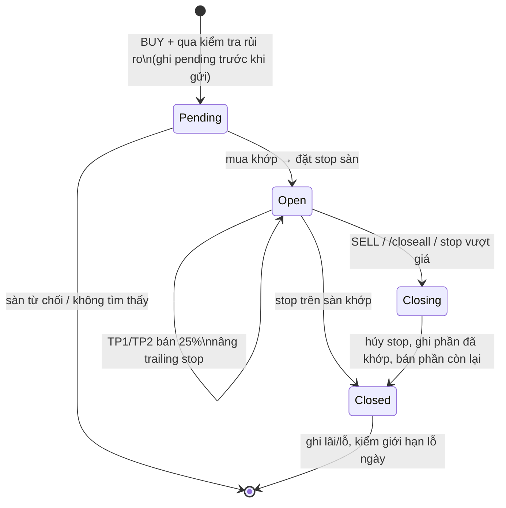

# 3. Thiết kế

## 3.1 Kiến trúc tổng quan

**Nguyên tắc thiết kế**
1. **Một nguồn sự thật cho tín hiệu:** agent, backtest và trang web cùng dùng `backtest/engine.cjs`.
2. **Tách quyết định khỏi thực thi:** `strategy` quyết định; `agent` áp luật rủi ro; `broker` nói chuyện với sàn.
3. **Tiêm phụ thuộc:** mọi thứ bên ngoài (broker, market, notifier, ai, store, đồng hồ, file system) truyền qua constructor để test.
4. **Thất bại an toàn:** lỗi dịch vụ phụ không chặn giao dịch; dữ liệu không hợp lệ thì dừng thay vì đoán.

## 3.2 Trách nhiệm module

| Module | Trách nhiệm | Giao diện chính |
|---|---|---|
| `index.js` | Đọc `.env`, cấu hình, khóa, dựng các thành phần; chạy vòng lặp / `--tick` / `--once` | `main()` |
| `config.js` | Đọc và kiểm tra `config.json` + `.env`; cổng an toàn live; tham số chiến lược theo khung | `loadConfig()`, `strategyParams()` |
| `strategy.js` | Đánh giá nến đã đóng gần nhất bằng engine | `evaluate(rows, params)` |
| `market.js` | Nến đã đóng, giá cuối, high/low 5 phút; đổi host khi bị chặn | `fetchClosedCandles()`, `fetchLastPrice()`, `fetchRange()` |
| `broker.js` | `PaperBroker` (mô phỏng số dư, phí) và `ExchangeBroker` (ccxt Binance): mua, bán, stop, hủy stop, tìm lệnh | `marketBuy()`, `marketSell()`, `placeStop()`, `cancelStop()`, `findBuy()` |
| `agent.js` | Luật giao dịch: xử lý nến mới, mở/quản lý/đóng vị thế, TP/SL, khôi phục, lệnh Telegram, thông báo | `start()`, `tick()` |
| `state.js` | Trạng thái bền vững theo chế độ, ghi nguyên tử, khóa một tiến trình, kiểm tra cấu trúc | `StateStore` |
| `notifier.js` | Gửi tin, đọc và phân quyền lệnh Telegram | `send()`, `poll()` |
| `ai.js` | Nhận xét tín hiệu bằng Claude (không ảnh hưởng quyết định) | `comment()` |
| `security.js` | Đăng ký secret, che giấu chuỗi nhạy cảm | `registerSecrets()`, `redact()`, `cleanErr()` |

## 3.3 Luồng một vòng kiểm tra (`tick`)

## 3.4 Vòng đời một vị thế

## 3.5 Mô hình dữ liệu (`data/state-<mode>.json`)

| Trường | Kiểu | Ý nghĩa |
|---|---|---|
| `version`, `mode` | số, chuỗi | Phiên bản cấu trúc; chế độ (phải khớp khi đọc) |
| `halted` | bool | `/stop` đã bật (chặn lệnh mới) |
| `lastBar[symbol]` | ms | Nến đã xử lý gần nhất |
| `positions[symbol]` | object | `qty`, `entry`, `sl`, `tps[]`, `stopId`, `stopBooked`, `realized`, `best`, `openedAt`… |
| `pending[symbol]` | object | Lệnh mua đã gửi chưa xác nhận (client order id) |
| `daily[YYYY-MM-DD]` | `{ realized }` | Lãi/lỗ trong ngày UTC |
| `paper` | `{ usdt, base }` | Số dư mô phỏng |
| `telegramOffset` | số nguyên | Update Telegram đã đọc |

Nhật ký giao dịch: `data/trades-<mode>.jsonl` (mỗi dòng một sự kiện open/tp/close). Log: `data/agent.log` (đã redact).

## 3.6 Thiết kế bảo mật

Xem [../SECURITY.md](../SECURITY.md): tài sản, ranh giới tin cậy, threat model STRIDE (T1–T13) và biện pháp.

## 3.7 Quyết định thiết kế (ADR rút gọn)

| # | Quyết định | Lý do | Phương án đã loại |
|---|---|---|---|
| D1 | Dùng chung engine với backtest | Không lệch giữa kết quả backtest và hành vi thật | Viết lại logic trong agent |
| D2 | Stop đặt trên sàn (STOP_LOSS_LIMIT) + agent tự theo dõi | Có bảo vệ cả khi agent tắt | Chỉ theo dõi trong agent |
| D3 | Lấy nến từ API công khai, kể cả testnet | Nến testnet khác thị trường thật | Nến testnet |
| D4 | Chạy theo lịch trên Actions ở paper, trạng thái ở nhánh `agent-state` | Không cần máy chạy liên tục, không lẫn với nhánh `main` | VPS riêng |
| D5 | Claude chỉ nhận xét | Quyết định phải lặp lại được và kiểm thử được | Để Claude quyết định vào lệnh |
